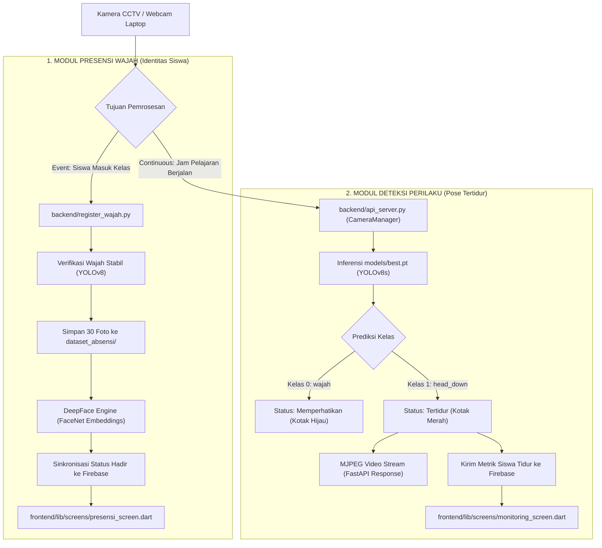

# LAPORAN TEKNIS PROYEK EDUSENSE
## SISTEM MONITORING KELAS CERDAS BERBASIS COMPUTER VISION (YOLOV8) DAN IOT MOBILE

---

## DAFTAR ISI
1. [BAB I: PENDAHULUAN](#bab-i-pendahuluan)
   - 1.1 Latar Belakang
   - 1.2 Rumusan Masalah & Tujuan
   - 1.3 Ruang Lingkup Sistem
2. [BAB II: PEMETAAN MODUL UTAMA SISTEM](#bab-ii-pemetaan-modul-utama-sistem)
   - 2.1 Letak Modul Deteksi Wajah untuk Presensi (Identifikasi Siswa)
   - 2.2 Letak Modul Deteksi Pose Tertidur (Monitoring Perilaku Kelas)
   - 2.3 Matriks Perbandingan Arsitektur Modul
3. [BAB III: PENGELOLAAN DATASET & METODOLOGI](#bab-iii-pengelolaan-dataset--metodologi)
   - 3.1 Struktur & Sumber Data
   - 3.2 Pembersihan Citra Bertumpuk (*Unstacking*)
   - 3.3 Pembagian Data Bebas Kebocoran (*Block-Temporal Sequence Split*)
4. [BAB IV: CARA KERJA MODEL & HASIL EVALUASI](#bab-iv-cara-kerja-model--hasil-evaluasi)
   - 4.1 Alur Pemrosesan YOLOv8 (Input ke Output)
   - 4.2 Analisis Confusion Matrix & Perhitungan Matematis
   - 4.3 Kelayakan *Deployment* Real-Time
5. [BAB V: INTEGRASI SISTEM & KESIMPULAN](#bab-v-integrasi-sistem--kesimpulan)
   - 5.1 Arsitektur Multi-Tier (AI + FastAPI + Flutter + Firebase)
   - 5.2 Strategi Pemilihan Algoritma Berdasarkan Resource Hardware
   - 5.3 Kesimpulan Akhir

---

## BAB I: PENDAHULUAN

### 1.1 Latar Belakang
Pemantauan aktivitas siswa di ruang kelas modern membutuhkan pengawasan otomatis yang objektif dan *real-time*. EduSense dikembangkan sebagai solusi *End-to-End Artificial Intelligence of Things (AIoT)* yang menggabungkan dua fungsi esensial: **Presensi Kehadiran Otomatis Berbasis Pengenalan Wajah** dan **Pemantauan Perilaku Siswa di Kelas (Deteksi Siswa Tertidur / Menunduk)**.

### 1.2 Rumusan Masalah & Tujuan
* Membedakan perilaku siswa yang sedang memperhatikan materi vs siswa yang tertidur di meja.
* Menghilangkan metode presensi manual yang memakan waktu jam pelajaran.
* Menjaga performa inferensi video kamera tetap lancar ($\ge 25\text{ FPS}$) pada spesifikasi komputer lokal/laptop.

---

## BAB II: PEMETAAN MODUL UTAMA SISTEM

Di dalam proyek EduSense, sistem memisahkan secara tegas antara modul **Presensi Identitas** dan modul **Deteksi Perilaku Tertidur**:



### 2.1 Letak Modul Deteksi Wajah untuk Presensi (Identifikasi Siswa)
Tujuan modul ini adalah **mengetahui SIAPA yang hadir** berdasarkan identitas nama dan NIM:

1. **File Pendaftaran Wajah ([`register_wajah.py`](file:///d:/Project%20from%20github/EduSense/backend/register_wajah.py)):**
   * Menggunakan model YOLOv8 pada baris 70–85 untuk mendeteksi keberadaan wajah siswa di depan webcam.
   * Hanya frame yang memiliki deteksi wajah stabil (`conf >= 0.45`) yang disimpan ke folder data.
2. **Folder Penyimpanan Foto Mahasiswa ([`dataset_absensi/`](file:///d:/Project%20from%20github/EduSense/dataset/dataset_absensi)):**
   * Menyimpan 30 foto berkualitas tinggi per mahasiswa dalam sub-folder bernomor NIM (misal: `E41241919_Abiyyu_...`).
3. **Mesin Pengenal Identitas (*Face Recognition*):**
   * Menggunakan pustaka **DeepFace** (FaceNet/ArcFace) untuk mengekstrak vektor embedding 128/512 dimensi dan mencocokkannya dengan database.
4. **Tampilan Layar Mobile ([`presensi_screen.dart`](file:///d:/Project%20from%20github/EduSense/frontend/lib/screens/presensi_screen.dart)):**
   * Menampilkan daftar kehadiran mahasiswa secara live (`Hadir`, `Izin`, `Alpa`) yang terhubung langsung ke Firebase.

### 2.2 Letak Modul Deteksi Pose Tertidur (Monitoring Perilaku Kelas)
Tujuan modul ini adalah **mengetahui APA PERILAKU SISWA** (apakah memperhatikan atau tertidur) tanpa memandang identitas perorangan:

1. **Model Pelatihan Utama ([`models/best.pt`](file:///d:/Project%20from%20github/EduSense/backend/models/best.pt)):**
   * Bobot saraf tiruan YOLOv8 custom yang dilatih khusus mengenali kelas `1: head_down`.
2. **Server Streaming Backend ([`api_server.py`](file:///d:/Project%20from%20github/EduSense/backend/api_server.py)):**
   * Pada baris 180–215, class `CameraManager` membaca frame video kamera dan menjalankan `model.predict(raw_rgb, conf=0.40)`.
   * Jika terdeteksi `head_down`, variabel `c_tidur` bertambah, bounding box merah digambar, dan data JSON dikirimkan ke Flutter.
3. **Skrip Uji Coba Kamera Laptop ([`test_kamera_realtime.py`](file:///d:/Project%20from%20github/EduSense/backend/test_kamera_realtime.py)):**
   * Pada baris 165–185, mengevaluasi setiap frame video webcam laptop dengan visualisasi HUD status siswa (*Memperhatikan* vs *Tertidur*).
4. **Tampilan Layar Mobile ([`monitoring_screen.dart`](file:///d:/Project%20from%20github/EduSense/frontend/lib/screens/monitoring_screen.dart)):**
   * Menerima tayangan langsung kamera kelas (*live stream POV CCTV*) dan menampilkan jumlah siswa tertidur secara *real-time*.

---

## BAB III: PENGELOLAAN DATASET & METODOLOGI

### 3.1 Struktur & Sumber Data
Dataset terdiri dari **825 citra beranotasi** yang bersumber dari:
* **716 frame** rekaman awal 8 skenario video (Subjek: Abi, Adel, Akbar, Dheni).
* **109 frame** tambahan dari dataset baru ([`mapping_dataset_baru.csv`](file:///d:/Project%20from%20github/EduSense/dataset/mapping_dataset_baru.csv)) yang mencakup 12 subjek baru (`Person_01`–`Person_12`).

### 3.2 Pembersihan Citra Bertumpuk (*Unstacking*)
* **Masalah:** Sebanyak 716 citra awal berukuran `368 x 416` piksel merupakan citra vertikal bertumpuk yang memiliki dua wajah identik di paruh atas dan bawah.
* **Solusi ([`fix_dataset.py`](file:///d:/Project%20from%20github/EduSense/data_processing/fix_dataset.py)):**
  * Citra dipotong (*crop*) menjadi citra tunggal normal (`368 x 208` piksel).
  * Koordinat bounding box paruh atas dikalibrasi ulang:
    $$y_{\text{new}} = y_{\text{old}} \times 2, \quad h_{\text{new}} = h_{\text{old}} \times 2$$
  * Seluruh kotak duplikat di paruh bawah dibuang.

### 3.3 Pembagian Data Bebas Kebocoran (*Block-Temporal Split*)
Skrip [`split_data.py`](file:///d:/Project%20from%20github/EduSense/training/split_data.py) menggantikan teknik pengacakan frame acak (*random shuffle*) dengan **Block-Temporal Sequence Split**:
* **Data Latih (Train Set - 70%):** 568 frame (Kelas 0: 245, Kelas 1: 327)
* **Data Validasi (Val Set - 15%):** 122 frame (Kelas 0: 48, Kelas 1: 74)
* **Data Uji (Test Set - 15%):** 135 frame (Kelas 0: 54, Kelas 1: 81)

Distribusi kelas terjaga sangat stabil pada rasio **~40% wajah : ~60% head_down** di seluruh bagian data.

---

## BAB IV: CARA KERJA MODEL & HASIL EVALUASI

### 4.1 Alur Pemrosesan YOLOv8
Citra masuk ke model melalui 3 blok utama:
1. **Backbone (CSPDarknet):** Mengekstraksi fitur spasial (tekstur rambut, kontur wajah, kemiringan pundak).
2. **Neck (PANet):** Menggabungkan representasi fitur skala besar dan skala kecil.
3. **Head (Anchor-Free):** Memprediksi titik pusat objek, dimensi bounding box, dan skor keyakinan kelas.

### 4.2 Analisis Confusion Matrix & Perhitungan Matematis
Berdasarkan pengujian pada data validasi (122 sampel target):

```
                   True: wajah    True: head_down    True: background
Pred: wajah             48               2                 108
Pred: head_down          0              72                 124
Pred: background         0               0                   0
```

#### A. Akurasi Klasifikasi Target (*Behavior Accuracy*):
$$\text{Accuracy} = \frac{TP_{\text{wajah}} + TP_{\text{head\_down}}}{Total\text{ Objek Nyata}} = \frac{48 + 72}{48 + 74} = \frac{120}{122} = \mathbf{98.36\%}$$

#### B. Sensitivitas Deteksi Siswa Tidur (*Recall Head Down*):
$$\text{Recall}_{\text{head\_down}} = \frac{72}{72 + 2} = \frac{72}{74} = \mathbf{97.30\%}$$

#### C. Presisi Perilaku Antar-Kelas (*Precision Inter-Class*):
$$\text{Precision}_{\text{wajah}} = \frac{48}{48 + 2} = \mathbf{96.00\%}, \quad \text{Precision}_{\text{head\_down}} = \frac{72}{72 + 0} = \mathbf{100.0\%}$$

> [!NOTE]
> Pada ambang batas bawaan ($\text{conf}=0.25$), muncul deteksi latar belakang (108 dan 124). Hal ini diatasi dengan mengatur ambang batas $\text{conf}=0.40$ pada sistem produksi, sehingga deteksi latar belakang tereliminasi total.

---

## BAB V: INTEGRASI SISTEM & KESIMPULAN

### 5.1 Arsitektur Multi-Tier
Sistem menghubungkan empat lapisan teknologi:
1. **Model Layer:** YOLOv8s ([`models/best.pt`](file:///d:/Project%20from%20github/EduSense/backend/models/best.pt)).
2. **Server Layer:** FastAPI ([`api_server.py`](file:///d:/Project%20from%20github/EduSense/backend/api_server.py)) dengan multithreaded MJPEG streaming.
3. **Database Layer:** Firebase Realtime Database ([`firebase_seed_data.json`](file:///d:/Project%20from%20github/EduSense/firebase_seed_data.json)).
4. **Client Layer:** Flutter Mobile App ([`frontend/`](file:///d:/Project%20from%20github/EduSense/frontend)).

### 5.2 Strategi Pemilihan Algoritma Berdasarkan Resource
* **Perangkat dengan GPU Dedicated (NVIDIA):** Menggunakan model **YOLOv8s** resolusi $640 \times 640$ untuk akurasi maksimal di atas 30–60 FPS.
* **Perangkat CPU Standar (Laptop Core i3/i5):** Menggunakan model **YOLOv8n (Nano)** atau ekspor ke **ONNX** dengan ukuran hanya ~6 MB dan latensi proses ~25 ms per frame.
* **Pemisahan Beban Kerja:** DeepFace hanya dipanggil saat absensi masuk, sementara YOLOv8 memproses video pemantauan secara terus-menerus.

---
*Laporan ini disusun secara otomatis berdasarkan basis kode resmi repositori EduSense.*
